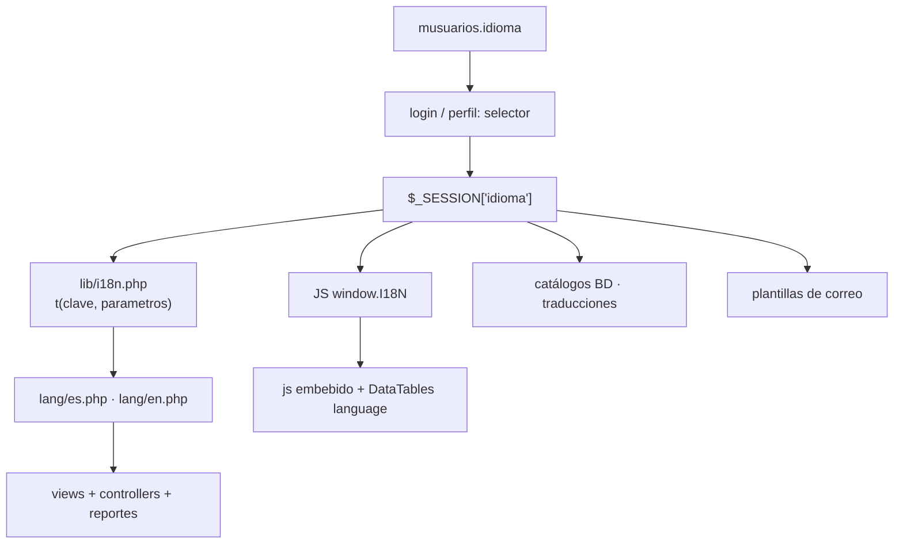

# Evaluación de viabilidad: multilenguaje en BOVS

**Fecha:** 2026-10-18
**Estado:** análisis archivado — **NO implementado.**
**Decisión:** por ahora no se aplica multilenguaje al sistema. Este documento se conserva como referencia por si se retoma más adelante.

Contiene dos escenarios evaluados:

- **Escenario A** — multilenguaje global, cualquier idioma.
- **Escenario B** — multilenguaje restringido a idiomas del continente americano.

---

## 1. Veredicto

**Técnicamente viable, pero es un proyecto grande, no una mejora.**

No existe ninguna infraestructura de idiomas hoy: hay que construirla desde cero y luego tocar prácticamente todas las capas. Estimación para 2 idiomas: **5–9 semanas** según el escenario (ver §8 y §9).

Recomendación general: hacerlo por fases y **sin prometer "todo el sistema" de golpe**. La fase 0 + 1 (infraestructura + shell) entrega el 80 % del valor percibido con el 15 % del esfuerzo.

---

## 2. Alcance real medido

| Área | Archivos | Líneas |
|---|---|---|
| `views/` (159 PHP; 118 incluyen `layouts/cabecera.php`) | 159 | 57 553 |
| `controllers/` | 48 | 24 207 |
| `js/` propios | — | 3 263 |
| `app_offline/` (PWA) | — | 17 952 |
| `Reportes/reportes/bovs/` | 34 | 9 440 |
| `lib/` | — | 3 506 |
| **Total expuesto al usuario** | | **≈ 88 000 líneas** |

---

## 3. Cadenas a traducir (estimación)

| Métrica | Cantidad |
|---|---|
| Literales PHP que empiezan en mayúscula (6–80 car.) en `views` + `controllers` | 1 675 |
| Literales JS (`"Mayúscula…"`) en `js/` y PWA | 190 |
| Etiquetas `<th>`, `<label>`, `<option>`, `<button>` | 1 239 |
| Atributos `placeholder=` | 274 |
| `alert()` / `confirm()` nativos embebidos | 429 |
| Caracteres acentuados: views 2 129 · controllers 742 · js 1 611 · reportes 298 · alertas/lib 578 | 5 358 |

→ **~3 500–4 500 cadenas únicas** (≈ 9 000 ocurrencias contando repeticiones).

---

## 4. Infraestructura existente: ninguna

| Comprobación | Resultado |
|---|---|
| `gettext()` / `_()` / `__()` | **0** |
| Carpeta `lang/`, archivos `.po` / `.mo` | **no existen** |
| `setlocale()` | 1 sola vez, en FPDF (`LC_NUMERIC,'C'`) |
| `<html lang="…">` | fijo `"es"` en `views/login.php:29` y `app_offline/index.html:2`; `views/layouts/cabecera.php` usa `<html>` **sin** `lang` |
| Charset | ✅ `UTF-8` correcto, definido en `views/layouts/constantes.php:8` |
| `mail/language/phpmailer.lang-*` | 34 archivos, pero son de PHPMailer, **no se usan** |
| Bloques `language` de DataTables | **173** copiados vista por vista |

Punto a favor: **todo el contenido ya está en UTF-8**, así que no hay que migrar datos.

---

## 5. Base de datos

- **55 tablas/vistas** tienen columna `nombre` o `descripcion` (texto mostrado en pantalla).
- **Cero** columnas `idioma` / `lang` / `locale` en toda la base.
- **`musuarios` no tiene columna de idioma** → requiere migración.
- Tamaño de los catálogos visibles:

| Catálogo | Filas | ¿Traducible? |
|---|---|---|
| `mrazas` | 315 | Parcial (nombres propios) |
| `mproductos` | 153 | No (nombres comerciales) |
| `mcategorias` | 136 | Sí |
| `mperiodos` | 77 | Fechas, no texto |
| `mcategoriaproductos` | 32 | Sí |
| `mpresentaciones` | 12 | Sí |
| `mestadofisiologicos`, `mestatusganados`, `mestatusanimales`, `mplanes`, `mroles`, `mapitudes`, `mcausadescartes`, `mcausamortaliidades`, `mtiposervicios`, `mtipoganaderias`, `mtipofundos`, `mtipousuarios`, `mtipomensajes` | ≤ 6 c/u | Sí |

→ El **volumen de datos traducible es pequeño** (~250 filas reales). El problema no es el tamaño, es el **número de consultas y pantallas** que los leen.

---

## 6. Bloqueadores técnicos

### 6.1 PDF (el más serio)

`Reportes/lib/general/fpdf/fpdf.php:1177` → `_pdfNormalizeText()` convierte **UTF-8 a ISO-8859-1** con `iconv('UTF-8','ISO-8859-1//TRANSLIT//IGNORE')`.

Consecuencia: **los 34 reportes solo pueden mostrar alfabetos latinos**. Con árabe, chino, ruso o griego el texto sale vacío o transliterado.

- **Opción A:** restringir a idiomas latinos. Coste 0.
- **Opción B:** migrar a **TCPDF/mPDF** con fuente Unicode (`DejaVuSans`). Hay que reescribir la clase `general` de reportes (`Cell`, `MultiCell`, `Row`, `NbLines`). Coste 2–3 semanas + revalidar los 34 reportes.

### 6.2 PWA / offline

`app_offline/` tiene **17 952 líneas** con textos en español incrustados, `VERSION_CACHE` en `service-worker.js` y versión en `versiones.json` (actual **4.40**). Los estáticos se sirven con `Cache-Control max-age=2592000` (30 días).

→ Cada cambio de diccionario obliga a **subir versión y forzar actualización del service worker**. Plan: `app_offline/js/lang/es.json` y `en.json` precacheados **ambos** en `ARCHIVOS_SHELL`, idioma resuelto en runtime.

### 6.3 Correos

`alertas/class.phpmailer.php:59` trae `CharSet = 'iso-8859-1'` por defecto. Ya existe `lib/mailer_helper.php` donde fijar `UTF-8`, pero las **plantillas de `alertas/`** (código, backup, inactividad, promo) están en español dentro del PHP → parametrizar por idioma del destinatario.

### 6.4 JavaScript embebido

- **105 vistas** contienen bloques `<script>` con texto en español.
- **429** llamadas a `alert()` / `confirm()` con mensajes literales.
- **173** bloques `language` de DataTables duplicados.

→ Hace falta (a) helper JS global `t()` inyectado desde `cabecera.php`, (b) un único objeto `language` de DataTables generado en PHP, (c) reemplazo mecánico de los 429 mensajes.

### 6.5 Formatos y locale

**69** usos de `toLocale…` / `es-VE` / `es_ES`. Hay que centralizarlos en una función que use el locale activo (números `1.234,56` vs `1,234.56`, fechas `dd-mm-yyyy` vs `mm/dd/yyyy`). Bajo esfuerzo, pero ahí aparecen los bugs sutiles.

---

## 7. Arquitectura propuesta



Piezas:

1. **`lib/i18n.php`** (nuevo): `bovs_i18n_init()`, `t($clave, $params)`, `bovs_i18n_actual()`, `bovs_i18n_disponibles()`, `bovs_i18n_payload_js()`. Carga perezosa del diccionario por dominio (`lang/es/fundos.php`, `lang/es/comun.php`…).
2. **`lang/{es,en}/*.php`**: arrays planos `'fundos.titulo' => 'Fundos'`.
3. **Migración SQL**: `ALTER TABLE musuarios ADD COLUMN idioma varchar(5) DEFAULT 'es'` + tabla `idiomas(codigo, nombre, activo)`.
4. **`views/layouts/cabecera.php`**: `<html lang="...">` + `window.I18N = {...}` antes de los JS de vista.
5. **`js/i18n.js`**: `t()`, `I18N.fecha()`, `I18N.numero()`, `I18N.dataTable()` (objeto `language` completo), `I18N.moneda()`.
6. **Selector de idioma** en `views/layouts/menu_perfil_usuario.php` + acción `cambiar_idioma` en `controllers/musuarios_controller.php`.
7. **Catálogos BD**: tabla genérica `traducciones(idioma, tabla, registro_id, campo, texto)` con `COALESCE(tr.texto, base.nombre)` en los `data_json/` y controladores que devuelven catálogos. Una sola tabla para 20 catálogos, sin tocar el esquema de ninguno.
8. **Reportes**: `t()` en las 34 plantillas + decisión del §6.1.
9. **PWA**: `js/lang/*.json`, precache de ambos, bump de `versiones.json` y `VERSION_CACHE`.
10. **`musuarios.idioma` debe viajar en el payload de sincronización** (`api/sync_controller.php`) para que el modo offline respete el idioma.

---

## 8. Escenario A — multilenguaje global (cualquier idioma)

| Fase | Contenido | Esfuerzo |
|---|---|---|
| **0** | Infra: `lib/i18n.php`, `lang/`, migración SQL, `js/i18n.js`, `<html lang>`, selector en perfil | 4–5 días |
| **1** | Shell: `cabecera.php`, `menu_lateral_izquierdo.php` (90 enlaces), `login.php`, mensajes de sesión/permisos, `data_json` comunes | 1 semana |
| **2** | Módulos core: animales, fundos, usuarios, lotes, potreros, servicios, producción, sanidad (~70 % de las cadenas) | 3–4 semanas |
| **3** | 429 `alert/confirm` + 173 `language` de DataTables + formatos fecha/número | 1 semana |
| **4** | 34 reportes PDF/Excel + plantillas de correo | 1–2 semanas |
| **5** | PWA `app_offline/` + IndexedDB + service worker | 1 semana |
| **6** | Catálogos BD (`traducciones`) + pantallas de administración | 1 semana |
| | **Total 2 idiomas latinos** | **7–9 semanas** |
| | Cada idioma latino extra | +3–5 días (solo diccionario) |
| | Idiomas no latinos (árabe, chino, ruso…) | +2–3 semanas (motor PDF) |

Coste adicional en A: fuentes TTF empotradas, *shaping* RTL, segmentación de palabras CJK, reglas de mayúsculas por locale, expansión de texto extrema y QA de 34 reportes por alfabeto.

---

## 9. Escenario B — solo idiomas del continente americano

**Resultado: el esfuerzo baja a 5–6 semanas (−25/−30 %) y el riesgo técnico baja ~70 %.** La complejidad *estructural* baja poco; la complejidad *peligrosa* baja casi a cero.

### 9.1 Qué desaparece

Todos los idiomas americanos usan **alfabeto latino y escritura de izquierda a derecha**:

| Bloqueador del Escenario A | Estado en B |
|---|---|
| Reemplazo de FPDF por TCPDF/mPDF con fuente Unicode | **Eliminado** (2–3 semanas ahorradas) |
| Fuentes TTF empotradas, subsetting, licencias | **Eliminado** |
| Dirección RTL / *bidi* / *shaping* | **Eliminado** |
| Segmentación de palabras sin espacios (chino, japonés) | **Eliminado** |
| Reglas de mayúsculas por locale (caso turco `i/İ`) | **Eliminado** |
| Expansión de texto extrema (+30 % alemán, −40 % chino→inglés) | **Eliminado** |
| QA de PDFs con alfabetos no latinos (34 reportes × N idiomas) | **Eliminado** |

### 9.2 Qué NO cambia

El 80 % del trabajo es mecánico y sigue igual:

| Trabajo | Volumen | ¿Baja? |
|---|---|---|
| Extraer cadenas de `views/` | 1 675 literales + 1 239 etiquetas + 274 placeholders | No |
| JS embebido y `alert()/confirm()` | 105 vistas + 429 mensajes | No |
| Bloques `language` de DataTables | 173 | No |
| `controllers/` | 742 acentos | No |
| PWA `app_offline/` + bump de versión | — | No |
| Catálogos en BD | 20+ tablas, ~250 filas | No |
| Plantillas de correo en `alertas/` | 4 flujos | No |
| Helper `t()`, diccionarios, selector, migración | Fase 0 | No |

### 9.3 Coste por idioma americano

| Idioma | Familia | Coste tras la fase 0 | Notas |
|---|---|---|---|
| **es** (base) | — | — | Ya está hecho |
| **en** (EE. UU./Canadá) | Latín | 3–5 días | Texto más corto; separador decimal `.` |
| **pt-BR** | Latín | 3–5 días | Coma decimal; +18 % longitud |
| **fr-CA** | Latín | 4–6 días | +20 % longitud; espacio fino en miles |
| **ht** (criollo haitiano) | Latín | 3–4 días | Sin caracteres especiales |
| **qu / ay** (quechua, aimara) | Latín | 4–6 días | Diacríticos dentro de ISO-8859-1 |
| **gn** (guaraní) | Latín | 5–7 días | **Único caso borde**, ver §9.4 |

### 9.4 Único caso borde: guaraní

El guaraní usa vocales nasales (`ã ẽ ĩ õ ũ`), todas presentes en ISO-8859-1, **excepto `g̃`** (g + tilde combinante U+0303), que no existe en Latin-1.

Con `iconv(..., 'ISO-8859-1//TRANSLIT//IGNORE')` ese carácter se degrada silenciosamente (queda `g` o `~`) **solo en los PDFs**.

- **(A)** Reemplazo explícito `g̃ → ĝ` antes de imprimir. Coste: 1 hora. **Recomendada.**
- **(B)** Si el guaraní fuese requisito formal sin tolerancia al reemplazo, ahí sí habría que ir a TCPDF solo para ese idioma.

### 9.5 Lo que sigue siendo necesario en B

Aunque los idiomas sean latinos, **hace falta igual el helper de formato regional**, porque es/pt/fr usan coma decimal y en usa punto:

$$1{,}5\ \text{kg (es, pt, fr)} \quad \text{vs} \quad 1.5\ \text{kg (en)}$$

Los **69 usos** de `toLocale`/`es-VE`/`es_ES` hay que unificarlos igual. Es barato (medio día), pero si se omite aparecen los bugs más molestos: precios y pesos mal leídos en los reportes.

### 9.6 Fases en el Escenario B

| Fase | Contenido | A | **B** |
|---|---|---|---|
| 0 | Infra i18n + migración + selector | 4–5 d | **4–5 d** |
| 1 | Shell: cabecera, menú, login, mensajes | 1 sem | **1 sem** |
| 2 | Módulos core (~70 % de las cadenas) | 3–4 sem | **3–4 sem** |
| 3 | 429 alert/confirm + 173 DataTables + formatos | 1 sem | **1 sem** |
| 4 | 34 reportes + correos | 1–2 sem | **1–1,5 sem** |
| 5 | PWA offline | 1 sem | **1 sem** |
| 6 | Catálogos BD | 1 sem | **0,5–1 sem** |
| — | Migrar motor PDF a Unicode | 2–3 sem | **0** |
| | **Total es + en** | **7–9 sem** | **5–6 sem** |
| | Cada idioma latino extra | 3–5 d | **3–5 d** |

---

## 10. Comparativa A vs B

| Dimensión | A (global) | B (americano) |
|---|---|---|
| Esfuerzo total (es + en) | 7–9 semanas | **5–6 semanas** |
| Riesgo técnico | Alto (motor PDF, RTL, CJK) | **Bajo** |
| Trabajo mecánico (cadenas, vistas, JS) | ~80 % del total | **~95 % del total** |
| Idiomas soportados | Todos | Solo alfabeto latino |
| Cambios en el motor de reportes | Sí | **No** |
| Previsibilidad del cronograma | Media | **Alta** |

---

## 11. Alternativas más baratas

| Opción | Coste | Qué resuelve | Qué NO resuelve |
|---|---|---|---|
| **Traductor del navegador** (Chrome/Edge) | 0 | El usuario lee en su idioma sin tocar código | PDFs, PWA offline, correos, términos técnicos destrozados |
| **Widget de Google Translate** | 1 día | Parecido, dentro del sitio | Igual + dependencia externa y peso |
| **i18n solo de UI (sin BD ni reportes)** | 2–3 semanas | Menús, formularios, mensajes | Catálogos siguen en español, PDFs en español |
| **i18n solo es/en completo** | 5–7 semanas | Todo excepto alfabetos no latinos | Árabe/asiáticos |

---

## 12. Riesgos

1. **Regresión silenciosa:** `php -l` no valida el JS embebido; mantener el chequeo `node --check` sobre los bloques `<script>` de cada vista tocada.
2. **Caché de estáticos a 30 días:** sin bump de `?v=N` los usuarios verán diccionarios viejos mezclados con HTML nuevo.
3. **PWA ya instalada:** si el service worker no cambia `VERSION_CACHE`, la app offline seguirá en español indefinidamente.
4. **Cadenas concatenadas:** hay textos armados con `.` en PHP y `+` en JS; al traducir hay que convertirlos a plantillas con parámetros (`{n}`), no traducir fragmentos.
5. **PHP 7.4/8.3:** el helper debe evitar `??`, `?->`, `match`, `str_contains` y tipos de unión.
6. **`musuarios` compartido con la PWA:** la columna `idioma` debe viajar en el payload de sincronización.

---

## 13. Recomendación registrada

1. Si se retoma: **fijar el alcance en idiomas americanos** (es, en, pt-BR, fr-CA + criollo). Ahorra 2–3 semanas y elimina el 70 % del riesgo.
2. **Documentar el límite explícitamente:** no se soportan alfabetos no latinos ni RTL, para evitar una petición de árabe/chino a mitad de camino.
3. **Invertir el ahorro en calidad**, no en más idiomas: usar esas 2–3 semanas en traducir bien los 34 reportes y las plantillas de correo.
4. **Arrancar por fase 0 + 1** (≈ 2 semanas) y medir el catálogo real antes de comprometer la fase 2.

---

## 14. Anexo: cómo reproducir las mediciones

```bash
cd /var/www/html/sovca

# Volumen
find views -name '*.php' | wc -l
find views -name '*.php' -exec cat {} + | wc -l
cat controllers/*.php | wc -l
cat app_offline/index.html app_offline/js/*.js | wc -l
cat Reportes/reportes/bovs/*.php | wc -l

# Cadenas
grep -rhEo "'[A-ZÁÉÍÓÚÑ¿¡][^']{6,80}'" --include=*.php views controllers | wc -l
grep -rhEo '"[A-ZÁÉÍÓÚÑ¿¡][^"]{6,80}"' --include=*.js js app_offline/js | wc -l
grep -rEo '<(th|label|option|button)[^>]*>' --include=*.php views | wc -l
grep -ro 'placeholder=' --include=*.php views | wc -l
grep -rho "alert(\|confirm(" --include=*.php views | wc -l
grep -ro --include=*.php -E '[áéíóúñÁÉÍÓÚÑ¿¡]' views | wc -l

# Infra existente
grep -rn "gettext" --include=*.php . | wc -l
test -d lang && echo "lang/ existe" || echo "sin lang/"
grep -rn "setlocale" --include=*.php .
grep -rn 'html lang=' views/layouts/*.php views/login.php app_offline/index.html
grep -rn "charset" views/layouts/constantes.php
grep -rn '"language"' --include=*.php views | wc -l

# Bloqueadores
grep -n "_pdfNormalizeText" -A 18 Reportes/lib/general/fpdf/fpdf.php | head -28
grep -n "CharSet" alertas/class.phpmailer.php | head -3
grep -n "VERSION_CACHE" app_offline/service-worker.js | head -3

# Base de datos
PGPASSWORD=postgres psql -h 127.0.0.1 -U postgres -d sovca_qas -tAc \
  "SELECT table_name FROM information_schema.columns
   WHERE table_schema='public' AND column_name IN ('nombre','descripcion') ORDER BY 1"
PGPASSWORD=postgres psql -h 127.0.0.1 -U postgres -d sovca_qas -tAc \
  "SELECT table_name||'.'||column_name FROM information_schema.columns
   WHERE table_schema='public'
     AND (column_name ILIKE '%idioma%' OR column_name ILIKE '%lang%' OR column_name ILIKE '%locale%')"
```
