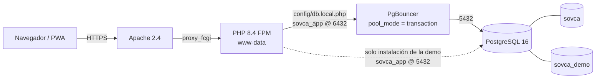

# Puesta en producción de SOVCA — manual de referencia

Documento único y definitivo: desde preparar el servidor hasta dejar el **modo
demostración** funcionando. Reemplaza a los runbooks sueltos que se fueron
escribiendo durante el despliegue (`plan_actualizacion_sovca.md` queda como
bitácora histórica, no como procedimiento).

Fecha de referencia: **2026-10-28** · probado en Ubuntu 24.04 + PostgreSQL 16 +
PgBouncer + PHP 8.4 (FPM).

---

## 0. Datos de esta instalación

| Dato | Valor |
|---|---|
| Aplicación | `/var/www/html/sovca` (hermana de `/var/www/html/bovs`) |
| Repositorio | `https://github.com/yamirezl/sovca.git`, rama `main` |
| Usuario del sistema que sirve | `www-data` (PHP-FPM) |
| Usuario que despliega | `root` |
| Base de datos | `sovca` |
| Base de demostración | `sovca_demo` |
| Rol de la aplicación | `sovca_app` (sin `SUPERUSER`, sin `CREATEDB`) |
| Puerto de la aplicación | **6432** (PgBouncer) |
| Puerto de administración | **5432** (PostgreSQL directo) |
| Verificación | `https://<dominio>/sovca/verificar_despliegue.php?k=sovca-verif-2026` |

---

## 1. Arquitectura



Dos puertos con propósitos distintos:

- **6432 (PgBouncer)** — todo el tráfico de la aplicación y de la sesión demo.
  Reutiliza conexiones; es la razón por la que existen `sovca_app` y el pooler.
- **5432 (directo)** — solo lo usan las tareas de **administración**: crear la
  base demo, `pg_dump`, `psql`, migraciones. El pooler no puede crear bases y
  su `[databases]` no incluye `postgres`.

---

## 2. Reglas de oro

Cada regla existe porque ya falló alguna vez; están en orden de frecuencia.

1. **Git como `root`, la aplicación como `www-data`.**
   `sudo -u www-data git status` responde `detected dubious ownership` porque el
   repo es de `root`. Usá `git -C /var/www/html/sovca ...` como root.
2. **Nunca `sudo -u postgres php ...`.** Con permisos `750 root:www-data`, el
   usuario del sistema `postgres` no puede leer el código y PHP responde
   `Could not open input file`. Los scripts PHP se ejecutan como `root`; las
   credenciales de base van en `config/db.local.php`.
3. **Nunca un superusuario en `config/db.local.php`.** Ahí va `sovca_app` y
   nada más. El único paso que necesita superusuario es un `createdb` puntual.
4. **`config/db.local.php` no se versiona y no se `push`ea.** Sobrevive a
   `git reset --hard`; por eso también hay que **limpiarlo a mano** cuando
   cambia un criterio (lección del despliegue: quedaron `define()` viejos
   apuntando a `postgres` y el instalador del demo administraba con él).
5. **Nunca `chmod 777`.** Ver §10.
6. **`sovca` y `bovs` son hermanos, no un solo proyecto.** Se leen los cambios
   del otro para portarlos, pero **no se edita** el otro directorio sin que esté
   pedido explícitamente.
7. **`php -l` no valida todo**: no detecta `define()` duplicados ni sintaxis de
   JavaScript embebido. Para credenciales, usar el `php -r` de §7.

---

## 3. Requisitos del servidor

```bash
apt update
apt install -y apache2 postgresql-16 postgresql-client-16 pgbouncer git unzip \
    php8.4-fpm php8.4-pgsql php8.4-mbstring php8.4-xml php8.4-curl \
    php8.4-gd php8.4-zip php8.4-intl php8.4-bcmath

a2enmod proxy_fcgi setenvif
a2enconf php8.4-fpm
```

Comprobación rápida:

```bash
php -v                                   # 8.4.x
psql --version                           # 16.x
pg_dump --version                        # >= la versión del servidor
systemctl is-active apache2 php8.4-fpm postgresql pgbouncer
```

> Si el servidor usa `libapache2-mod-php` en lugar de FPM, los permisos de §10
> son iguales pero la recarga es `systemctl reload apache2` y no existe
> `php8.4-fpm`.

---

## 4. Paso 1 · Código

```bash
cd /var/www/html
git clone https://github.com/yamirezl/sovca.git sovca
git -C sovca log --oneline -1
```

El repositorio queda a nombre de `root` (correcto: el código no debe ser
escribible por el usuario que sirve la web). Los permisos se ajustan en §10.

> `lib/fpdf` está versionado normalmente. Si en algún clon apareciera vacío, es
> que se coló un repositorio anidado: `ls -a lib/fpdf` y `du -sh lib/fpdf`.

---

## 5. Paso 2 · Base de datos y rol de aplicación

Orden correcto en una instalación nueva:

1. **Crear el rol** `sovca_app` — §5.2 (la base se crea con `-O sovca_app`, así
   que el rol tiene que existir antes).
2. **Crear la base** — §5.1.
3. **Restaurar el volcado** — §5.1.

Si el servidor ya tiene el rol y la base (caso de una actualización), este paso
no se toca.

### 5.1 Crear la base (solo instalación nueva)

```bash
sudo -u postgres createdb -O sovca_app -E UTF8 \
     --lc-collate=es_ES.UTF-8 --lc-ctype=es_ES.UTF-8 -T template0 sovca
```

La colación **no es un detalle**: si el clúster nació en `C.UTF-8`, todos los
`ORDER BY` con acentos y `ñ` cambian respecto al servidor de origen. Comprobar
cuál usa el servidor del que se migra:

```bash
sudo -u postgres psql -Atc "select datname, datcollate, datctype from pg_database where datname like 'sovca%'"
```

Restauración de datos (si viene de otro servidor):

```bash
sudo -u postgres pg_restore --no-owner --no-privileges --exit-on-error \
     -d sovca /ruta/al/volcado.dump
```

### 5.2 Crear el rol de la aplicación

```bash
cd /var/www/html/sovca
openssl rand -base64 24 | tr -d '\n' | sudo tee /root/sovca_app.txt >/dev/null
sudo chmod 600 /root/sovca_app.txt

SOVCA_APP_PASS="$(cat /root/sovca_app.txt)" bash scripts/crear_usuario_sovca_app.sh
```

El script usa `sudo -u postgres psql` (autenticación *peer*, sin clave) y
concede, sobre `sovca` y `sovca_demo`:

- `CONNECT`, `TEMPORARY` en la base
- `USAGE` en el esquema `public`
- `SELECT, INSERT, UPDATE, DELETE` en todas las tablas
- `USAGE, SELECT` en todas las secuencias
- `EXECUTE` en las funciones
- `ALTER DEFAULT PRIVILEGES` (para las tablas que se creen después)

Si una base todavía no existe, la omite con `· <base> no existe: se omite`
(es normal antes de instalar el demo). **No** se otorga `CREATEDB` ni
`SUPERUSER`: el rol de la aplicación nunca debe poder crear bases.

Verificación (por el pooler, que es como se conecta la app):

```bash
PGPASSWORD="$(cat /root/sovca_app.txt)" psql -w -h 127.0.0.1 -p 6432 \
    -U sovca_app -d sovca -Atc "select current_user, current_database()"
```

> Si aquí sale `SASL authentication failed`, falta el paso §6.

---

## 6. Paso 3 · PgBouncer

Resumen de la configuración de referencia (`/etc/pgbouncer/pgbouncer.ini`):

```ini
[databases]
sovca      = host=127.0.0.1 port=5432 dbname=sovca
sovca_demo = host=127.0.0.1 port=5432 dbname=sovca_demo

[pgbouncer]
listen_port = 6432
auth_type   = scram-sha-256
auth_file   = /etc/pgbouncer/userlist.txt
pool_mode   = transaction
max_client_conn = 1000
```

`auth_type = scram-sha-256` es obligatorio con PostgreSQL 16: el servidor guarda
los secretos como SCRAM y PgBouncer no puede autenticar un secreto SCRAM si está
en modo `md5`.

Preparar el usuario y las bases con el script del repositorio:

```bash
cd /var/www/html/sovca

# 1) simulación: dice qué va a cambiar, sin escribir nada
sudo bash scripts/pgbouncer_preparar_usuario.sh --base=sovca,sovca_demo

# 2) aplicar (respalda los archivos, escribe el userlist, añade las bases
#    que falten y recarga el servicio)
sudo bash scripts/pgbouncer_preparar_usuario.sh --base=sovca,sovca_demo --aplicar
```

El script copia el secreto **tal cual** desde `pg_authid.rolpassword`
(`SCRAM-SHA-256$...`) a `/etc/pgbouncer/userlist.txt`:

```
"sovca_app" "SCRAM-SHA-256$4096:....."
```

**Cada vez que cambie la clave de `sovca_app`, el `userlist.txt` queda viejo** y
hay que volver a ejecutar el script. Ese es el origen del `SASL authentication
failed`.

Verificación:

```bash
sudo grep -c "sovca_app" /etc/pgbouncer/userlist.txt        # >= 1
sudo grep -n "sovca_demo" /etc/pgbouncer/pgbouncer.ini     # debe aparecer
systemctl status pgbouncer --no-pager | head -3
```

---

## 7. Paso 4 · `config/db.local.php`

Es el único archivo con credenciales y **no está versionado**. Contenido
completo (no agregar nada más):

```bash
cd /var/www/html/sovca
cat > config/db.local.php <<EOF
<?php
define('SOVCA_DB_HOST', '127.0.0.1');
define('SOVCA_DB_PORT', '6432');
define('SOVCA_DB_NAME', 'sovca');
define('SOVCA_DB_DEMO_NAME', 'sovca_demo');
define('SOVCA_DB_USER', 'sovca_app');
define('SOVCA_DB_PASS', '$(cat /root/sovca_app.txt)');
define('SOVCA_DEMO_ACTIVO', true);
EOF

php -l config/db.local.php
```

`config/db.php` deriva de ahí **todo** lo demás (`SOVCA_DEMO_USUARIO`,
`SOVCA_DEMO_CLAVE`, `SOVCA_OFICIAL_*`, `SOVCA_DEMO_ADMIN_*`). Por eso:

> **No definir nunca `SOVCA_DEMO_*` a mano** salvo `SOVCA_DEMO_ACTIVO`.
> Un `define('SOVCA_DEMO_USUARIO', 'postgres')` olvidado hace que la sesión demo
> (y el instalador) usen el superusuario y todo falle con errores que parecen
> de otra cosa.

Verificación (imprime una línea; la clave nunca se muestra):

```bash
php -r 'require "config/db.php"; require "config/demo.php";
printf("app=%s puerto=%s demo=%s admin_demo=%s\n",
  SOVCA_DB_USER, SOVCA_DB_PORT, SOVCA_DEMO_USUARIO, SOVCA_DEMO_ADMIN_USUARIO);'
```

Esperado: `app=sovca_app puerto=6432 demo=sovca_app admin_demo=sovca_app`.

Si `demo=` o `admin_demo=` dicen otra cosa, hay un `define()` de más en
`db.local.php` (regla 4).

---

## 8. Paso 5 · Migraciones y datos base

Los scripts de migración hacen **DDL** (`ALTER TABLE`, `CREATE INDEX`,
`CREATE VIEW`), y `sovca_app` **no es dueño** de las tablas: no puede. Se
ejecutan como `postgres`, **por el puerto 5432**, con el archivo local ignorado:

```bash
cd /var/www/html/sovca
export SOVCA_DB_IGNORAR_LOCAL=1
export SOVCA_DB_PORT=5432
export SOVCA_DB_USER=postgres
export SOVCA_DB_PASS='<clave de postgres>'

# 1) siempre en simulación primero y leer la salida
php scripts/actualizar_planes_fundos.php
php scripts/agregar_cierre_remoto_sesiones.php
php scripts/corregir_fk_servicio_nacimiento.php
php scripts/optimizar_indices_reportes.php
php scripts/actualizar_vista_animales_activos.php --dry-run
php scripts/actualizar_vistas_estatus_animal.php --dry-run

# 2) aplicar (cada script es idempotente)
php scripts/actualizar_planes_fundos.php --aplicar
php scripts/agregar_cierre_remoto_sesiones.php --aplicar
php scripts/corregir_fk_servicio_nacimiento.php --aplicar
php scripts/optimizar_indices_reportes.php --aplicar --analizar
php scripts/actualizar_vista_animales_activos.php
php scripts/actualizar_vistas_estatus_animal.php

unset SOVCA_DB_IGNORAR_LOCAL SOVCA_DB_PORT SOVCA_DB_USER SOVCA_DB_PASS
```

Los `.sql` de `scripts/` se aplican igual, con `psql`:

```bash
sudo -u postgres psql -d sovca -v ON_ERROR_STOP=1 -f scripts/migracion_conexiones_duracion.sql
sudo -u postgres psql -d sovca -v ON_ERROR_STOP=1 -f scripts/migracion_desincorporacion_indice_unico.sql
sudo -u postgres psql -d sovca -v ON_ERROR_STOP=1 -f scripts/migracion_potreros_aforo.sql
```

> **Por qué no por el 6432:** PgBouncer en `pool_mode = transaction` no está
> pensado para sesiones DDL largas y su `[databases]` no incluye `postgres`.
> Fijar `SOVCA_DB_PORT=5432` es obligatorio, no opcional.

Comprobar que las conexiones quedaron:

```bash
php scripts/diagnostico_conexiones.php
```

---

## 9. Paso 6 · Correo, firma y PWA

- **Correo** (`config/mail.php`): la clave del buzón vive en el archivo
  (`SOVCA_SMTP_PASS` la sobreescribe). Sin clave no salen los códigos de
  verificación del alta demo ni la recuperación de contraseña.
- **Firma de QR** (`lib/firma.php`): `SOVCA_FIRMA_SECRET` es **propia de SOVCA**
  y no se comparte con BOVS. Los QR de un sistema no deben validar en el otro.
  Ver `docs/seguridad_permisos_y_demo.md`.
- **PWA**: `manifest.php`, `sw.js` y `app_offline/versiones.json` se sirven con
  Apache; no requieren nada adicional. Para que la app instalada se actualice,
  subir siempre `versiones.json` y la versión del service worker a la vez.

---

## 10. Paso 7 · Permisos y Apache

El procedimiento completo, con el porqué de cada número, está en
**`docs/seguridad_permisos_y_demo.md`**. Resumen operativo:

```bash
APP=/var/www/html/sovca

chown -R root:www-data "$APP"
find "$APP" -type d -exec chmod 750 {} \;
find "$APP" -type f -exec chmod 640 {} \;

# Las dos carpetas donde la aplicación escribe
chown -R www-data:www-data "$APP/file" "$APP/dist/img/fotos_animales"
find "$APP/file" "$APP/dist/img/fotos_animales" -type d -exec chmod 770 {} \;
find "$APP/file" "$APP/dist/img/fotos_animales" -type f -exec chmod 660 {} \;

# Repositorio fuera del alcance de Apache
chown -R root:root "$APP/.git"
chmod 700 "$APP/.git"

# Credenciales: solo root y Apache
chown root:www-data "$APP/config/db.php" "$APP/config/db.local.php" \
                    "$APP/config/mail.php" "$APP/config/demo.php" \
                    "$APP/config/conexion.php"
chmod 640 "$APP/config/db.php" "$APP/config/db.local.php" \
          "$APP/config/mail.php" "$APP/config/demo.php" \
          "$APP/config/conexion.php"
```

En el vhost (además de `Options -Indexes`), impedir que se sirvan por HTTP los
directorios sensibles y que se ejecute PHP en las carpetas de subida:

```apache
<DirectoryMatch "^/var/www/html/(sovca|bovs)/(config|docs|scripts|php-activerecord|vendor|\.git)">
    Require all denied
</DirectoryMatch>

<FilesMatch "\.(sql|md|log|bak|ini|sh|gitignore)$">
    Require all denied
</FilesMatch>

<Directory /var/www/html/sovca/file>
    Options -Indexes -ExecCGI
    php_admin_flag engine off
</Directory>

<Directory /var/www/html/sovca/dist/img/fotos_animales>
    Options -Indexes -ExecCGI
    php_admin_flag engine off
</Directory>
```

Verificación:

```bash
sudo -u www-data test -r "$APP/index.php" && echo "código: OK"
sudo -u www-data test -w "$APP/file" && echo "file/: escribible"
sudo -u www-data test -w "$APP/config" || echo "config/: protegido"
sudo -u www-data test -r "$APP/.git" || echo ".git: protegido"
```

---

## 11. Paso 8 · Recargar servicios

```bash
apachectl configtest && systemctl reload apache2
systemctl reload php8.4-fpm
systemctl reload pgbouncer
```

`php-fpm` se recarga siempre después de tocar `config/db.local.php`: si el
`opcache` tiene el archivo viejo se siguen usando las credenciales anteriores.

---

## 12. Paso 9 · Verificación funcional

### Automática

```bash
curl -s "http://localhost/sovca/verificar_despliegue.php?k=sovca-verif-2026" | tail -40
```

Comprueba presencia y permisos de los archivos críticos, la versión de
`app_offline/versiones.json` y que la conexión a base funcione.

### Manual (en el navegador)

1. `/sovca/views/login` → entra con un usuario real.
2. **Inicio** carga sin errores en consola.
3. **Animales**: listado y una ficha.
4. **Nacimientos**: abrir el formulario (es el módulo con más validaciones).
5. **Un reporte en PDF** desde el gestor de reportes.
6. **Cerrar sesión** → vuelve al login.
7. **Instalar app** (PWA): el botón aparece en el login.
8. **BOVS sigue funcionando** (`http://localhost/bovs/views/login`). Es
   obligatorio comprobarlo después de cualquier cambio de permisos: es el
   vecino que se rompe en silencio.

Si algo falla, el log de Apache dice el motivo real (`display_errors` está en
`Off`, los avisos no salen en el HTML):

```bash
sudo tail -50 /var/log/apache2/error.log
```

---

## 13. Paso 10 · Modo demostración (`sovca_demo`)

### 13.1 Crear la base — único paso con superusuario

```bash
sudo -u postgres createdb -O sovca_app -E UTF8 \
     --lc-collate=es_ES.UTF-8 --lc-ctype=es_ES.UTF-8 -T template0 sovca_demo
```

`-O sovca_app` la deja a nombre del rol de la aplicación: así el instalador
puede restaurar estructura, catálogos y secuencias sin privilegios. La colación
se fija igual que la base real.

### 13.2 Copiar estructura y catálogos

```bash
cd /var/www/html/sovca
php scripts/demo_instalar.php
```

Como `root`, **nunca** `sudo -u postgres php`. Salida esperada:

```
CONFIGURACIÓN
  Sesión demo : sovca_app@127.0.0.1:6432/sovca_demo
  Instalación : sovca_app@127.0.0.1:5432
  Origen      : sovca

· La base sovca_demo ya existe (se reutiliza)...
· Preparando extensiones...
  pgcrypto: creada
  pg_stat_statements: omitida (requiere superusuario, la demo no la necesita)
· Copiando estructura desde sovca...
  estructura copiada.
· Copiando catálogos básicos...
  catálogos cargados.
· Ajustando secuencias...
· Preparando tablas propias del modo demo...
BASE DE PRUEBAS LISTA
```

Cómo se resuelve lo que antes exigía superusuario:

| Necesidad | Solución en el instalador |
|---|---|
| `CREATE DATABASE` | lo hace el `createdb -O` de §13.1; si falta, el script se detiene y muestra el comando exacto |
| `ALTER TABLE ... DISABLE TRIGGER` | solo se pide si el rol es superusuario |
| `CREATE EXTENSION pg_stat_statements` | se omite con aviso (la demo no la usa); `pgcrypto` sí se crea porque es *trusted* |
| permisos del rol | la base ya es suya (`-O sovca_app`) |

Opciones: `--recrear` (borra y crea; requiere `CREATEDB` o hacerlo a mano con
`dropdb`), `--purgar` (desactiva cuentas vencidas, para cron),
`--sin-catalogos`, `--origen=`, `--destino=`.

### 13.3 Rutear la base en el pooler

```bash
sudo bash scripts/pgbouncer_preparar_usuario.sh --base=sovca,sovca_demo --aplicar
```

**La sesión demo se conecta por el 6432.** Si `sovca_demo` no está en
`[databases]`, el formulario muestra «la base de datos de pruebas no está
disponible» aunque la base exista.

### 13.4 Verificar

```bash
php -r 'require "config/demo.php"; require "lib/demo_helper.php";
echo bovs_demo_bd_disponible() ? "DISPONIBLE\n" : "NO DISPONIBLE\n";'
```

Si dice `NO DISPONIBLE`, la propia pantalla del demo muestra el destino probado
y el error (`Destino:` / `Detalle:`), que es lo que hay que leer para saber si
es el pooler, la clave o una tabla que falta.

Después, en el navegador: `/sovca/views/login` → **Acceso demostrativo**.

### 13.5 Apagar la demo

```bash
# en config/db.local.php
define('SOVCA_DEMO_ACTIVO', false);
```

Desaparece el botón del login y las sesiones que hubieran quedado marcadas
vuelven a la base real.

---

## 14. Actualización rutinaria (nueva versión del código)

```bash
cd /var/www/html/sovca

git status --short          # no debe haber cambios locales en archivos versionados
git fetch origin
git log --oneline HEAD..origin/main      # ver qué entra

# Opción A (sin cambios locales): avance normal
git pull --ff-only

# Opción B (árbol desincronizado o pruebas): imponer el del repositorio
# git reset --hard origin/main           # db.local.php NO se toca (no está versionado)

git log --oneline -1        # confirmar que quedó el commit esperado

# Si la versión trae migraciones: §8
# Si cambió config/db.local.php o la clave: §6 y §7
systemctl reload php8.4-fpm
```

> Comprobar siempre `git log --oneline -1` **en el servidor**: durante el
> despliegue de SOVCA se dieron por aplicados cambios que nunca llegaron porque
> el `pull` no se ejecutó, y cada intento fallaba con el mismo error viejo.

---

## 15. Rollback

```bash
cd /var/www/html

# 1) Volver al commit anterior
git -C sovca reset --hard <commit-anterior>
systemctl reload php8.4-fpm

# 2) Si la versión aplicó migraciones, restaurar el volcado previo
sudo -u postgres pg_restore --clean --no-owner --no-privileges \
     -d sovca /ruta/al/volcado_previo.dump
```

Antes de cualquier actualización grande: `pg_dump -Fc -d sovca -f /root/sovca_$(date +%F).dump`.
La carpeta antigua (`sovca-viejo`) solo se borra cuando la verificación de §12
está completa; hasta entonces es el rollback más rápido.

---

## 16. Problemas conocidos y su causa real

| Síntoma | Causa | Solución |
|---|---|---|
| `fatal: detected dubious ownership` | repo de `root`, git ejecutado como `www-data` | usar `git -C /var/www/html/sovca` como root |
| `Could not open input file: scripts/...php` | `sudo -u postgres php` con permisos `750 root:www-data` | ejecutar como `root` |
| `SASL authentication failed` en **6432** | el rol no está en `userlist.txt` o la clave cambió | §6 |
| `SQLSTATE[08006] ... port 6432` al instalar el demo | el instalador administraba por el pooler | el instalador usa 5432; no poner `SOVCA_DEMO_ADMIN_*` |
| `password authentication failed for user "postgres"` | `define()` viejos en `db.local.php` forzando `postgres` | reescribir `db.local.php` (§7) y verificar |
| `permission denied to create extension "pg_stat_statements"` | el volcado trae `CREATE EXTENSION` y el rol no es superusuario | el instalador lo omite (versión ≥ `56d51e9`) |
| `must be owner of table demo_registros` (log) | tablas del demo creadas por otro rol | base creada con `-O sovca_app` |
| El formulario demo dice «no está disponible» con la base creada | `sovca_demo` fuera de `[databases]` | §13.3 |
| `no such database: sovca_demo` | igual que el anterior | §13.3 |
| Los reportes PDF salen vacíos | `display_errors` en `On` mete avisos antes del PDF | `php_admin_flag display_errors off` |
| La PWA no se actualiza | caché del service worker | subir `versiones.json` + versión del SW |

---

## 17. Checklist final

- [ ] `git log --oneline -1` en el servidor = commit esperado
- [ ] `config/db.local.php` solo con `SOVCA_DB_*` + `SOVCA_DEMO_ACTIVO`
- [ ] `php -r` de §7 devuelve `sovca_app` en los tres campos
- [ ] `psql` por 6432 conecta (`sovca` y `sovca_demo`)
- [ ] `verificar_despliegue.php?k=sovca-verif-2026` sin rojos
- [ ] Login, animales, nacimientos, un PDF y cerrar sesión
- [ ] **BOVS sigue funcionando**
- [ ] Permisos: código `640`, `file/` y fotos escribibles, `.git` protegido
- [ ] `curl` a `/sovca/config/mail.php` responde 403
- [ ] Acceso demostrativo abre el formulario sin el recuadro de error
- [ ] Copia de seguridad reciente en `/root/`
