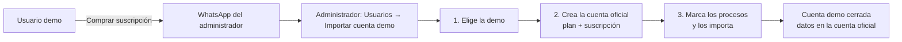

# Modo demostración (acceso con base de datos de pruebas)

El sistema puede ofrecerse en modo demostrativo: un visitante entra al login,
pulsa **Acceso demostrativo**, se crea su propia cuenta y empieza a trabajar
inmediatamente en una **base de datos aparte** (`bovs_demo`) que tiene la misma
estructura que la base real y solo los **catálogos básicos** cargados.

- **Verificación del correo obligatoria**: la cuenta se crea recién cuando el
  visitante escribe el código de 6 dígitos que recibe por correo.
- Vigencia de la cuenta: **15 días** (configurable).
- Rol: **PRODUCTOR (2)**, con su propio fundo de prueba creado automáticamente.
- Cada usuario demo trabaja en **su propio fundo**: los datos no se mezclan
  entre demos y los datos reales de producción nunca se copian ni se tocan.
- Muchos usuarios demo pueden estar conectados al mismo tiempo.

---

## 1. Cómo está armado

| Pieza | Archivo | Para qué |
|---|---|---|
| Configuración | `config/demo.php` | Nombre de la base, credenciales, días de vigencia, plan, límites. |
| Lógica | `lib/demo_helper.php` | Conexión PDO a la base demo, solicitud + verificación del correo, alta de cuenta, autenticación, sesión, purga. |
| Pantalla | `views/demo/index.php` | Formulario público + paso de verificación con código de 6 dígitos. |
| Endpoint | `controllers/demo_controller.php` | `crear_cuenta`, `verificar_codigo`, `reenviar_codigo`, `estado`, `salir`. |
| Instalador | `scripts/demo_instalar.php` | Crea la base, copia estructura y catálogos, ajusta secuencias. |
| Botón | `views/login.php` | Enlace “Acceso demostrativo” + aviso de cuenta vencida. |
| Login | `controllers/musuarios_controller.php` | Respaldo: si el usuario no existe en la base real, se busca en la demo. |

### El aislamiento de la base

`config/conexion.php` decide la cadena de conexión de php-activerecord así:

```
sesión normal  → pgsql://…/sovca_qas
sesión demo    → pgsql://…/bovs_demo      ($_SESSION['demo'] === 1)
```

Como todos los modelos usan la conexión por defecto, **no hay que cambiar
ningún módulo**: listados, formularios, reportes y vistas funcionan igual, solo
que contra la base de pruebas.

---

## 2. Puesta en marcha

```bash
# 1) Crear la base de pruebas (estructura + catálogos)
php scripts/demo_instalar.php

# 2) Verificar en config/demo.php
#    BOVS_DEMO_ACTIVO = true
```

Requisitos:

- `pg_dump` y `psql` en el `PATH` (paquete `postgresql-client`).
- El usuario configurado (`BOVS_DEMO_USUARIO`) debe poder **crear bases de datos**.
- `pg_dump` debe ser de la misma versión o superior al servidor.
- **Correo saliente configurado** (`config/mail.php` o variable `BOVS_SMTP_PASS`):
  el alta demo exige verificar el correo. Sin SMTP nadie puede crear una
  cuenta demo (el instalador lo avisa al terminar).

Opciones del instalador:

| Opción | Efecto |
|---|---|
| `--recrear` | Borra la base destino y la vuelve a crear desde cero (útil para “resetear” la demo). |
| `--purgar` | Desactiva las cuentas demo vencidas y sus fundos (no borra filas). |
| `--sin-catalogos` | Solo estructura, sin datos de catálogo. |
| `--origen=` / `--destino=` | Cambiar las bases (por defecto `sovca_qas` → `bovs_demo`). |

### Qué se copia

- **Estructura completa**: tablas, vistas, secuencias, índices y restricciones.
- **Catálogos globales**: `mroles`, `mtipousuarios`, `mtipofundos`,
  `mtipoganaderias`, `mtipoganados`, `mtiposervicios`, `mtipomensajes`,
  `mplanes`, `msuscripciones`, `maptitudes`, `mestadofisiologicos`,
  `mestatusganados`, `mestatusanimales`, `mcausadescartes`,
  `mcausamortalidades`, `mcategoriaganados`, `mpaises`, `mestados`,
  `mmunicipios`, `mparroquias`, `mmensajes`, `mdetamensajes`,
  `mpromomensajes`.
- **Catálogos mixtos** (solo las filas globales, `mfundos_id = 0`):
  `mcategorias`, `mcategoriaproductos`, `mconsecutivopesos`, `mperiodos`,
  `mpresentaciones`, `mproductos`, `mrazas`, `mmetaservicios`.

Todo lo operativo (animales, lotes, servicios, nacimientos, controles,
desincorporaciones, usuarios y fundos reales) queda **vacío**.

Además, el instalador (y cada petición, de forma idempotente) crea las dos
tablas propias del modo demo:

| Tabla | Para qué |
|---|---|
| `demo_verificaciones` | Solicitudes pendientes: datos de la cuenta, hash del código, expiración, intentos y último envío. |
| `demo_registros` | Bitácora de cuentas creadas: usuario, fundo, correo, IP, vencimiento y `email_verificado`. |

---

## 3. Varios usuarios demo a la vez

El diseño soporta **muchas cuentas demo simultáneas**:

- Cada usuario tiene su **propia sesión** y su **propio fundo**; todas las
  consultas del sistema ya filtran por `mfundos_id`, así que dos demos nunca
  se ven los datos entre sí.
- La solicitud y la creación de la cuenta van en **transacciones cortas**; los
  duplicados concurrentes de usuario/correo los resuelve la base (índice único
  `uq_musuarios_username_activo`) y el sistema responde con un mensaje claro.
- La creación de las tablas de apoyo ignora los errores de "ya existe": dos
  peticiones simultáneas no rompen el registro.
- El límite por IP (`BOVS_DEMO_MAX_POR_IP`, por defecto **20 por día**) está
  pensado para no bloquear a varias personas de una misma oficina que comparten
  salida a Internet. Si se espera un uso masivo desde una sola IP, se sube o se
  pone en `0`.
- Recomendaciones de infraestructura: `max_connections` de PostgreSQL por
  encima del número de usuarios previsto y `pm.max_children` de PHP-FPM acorde.

---

## 4. Qué se copia

---

## 5. Flujo del visitante

1. Login → botón **Acceso demostrativo** (`views/login.php`).
2. Pantalla `views/demo/index.php`, paso 1:
   - nombre, correo, usuario, contraseña (con la misma política del sistema),
   - nombre del fundo (opcional; por defecto `Fundo Demo <USUARIO>`),
   - captcha (el mismo del login) y aceptación de condiciones.
3. `demo_controller.php` → `bovs_demo_solicitar_cuenta()`:
   - valida duplicados de usuario/correo y el límite por IP,
   - guarda la solicitud en `demo_verificaciones`,
   - envía un **código de 6 dígitos** al correo (15 minutos, un solo uso).
   **Todavía no existe usuario ni fundo.**
4. Paso 2 en la misma pantalla: el visitante escribe el código.
   `bovs_demo_confirmar_cuenta()` comprueba el código (máx. 5 intentos) y,
   solo si es correcto:
   - crea `musuarios` (rol 2, correo ya verificado),
   - crea `mfundos` + `mfundosxusuarios` + `mplanesxfundo` (hoy → +15 días),
   - registra la cuenta en `demo_registros` con `email_verificado = true`,
   - deja la sesión iniciada con `$_SESSION['demo'] = 1`.
5. Entra directo al panel de inicio con sus menús de productor.

Botones del paso 2: **Reenviar código** (con espera mínima de 60 s) y
**Cambiar mis datos** (vuelve al formulario y pide un captcha nuevo).

Si el visitante vuelve otro día, puede iniciar sesión **desde el formulario
normal**: el login no lo encuentra en la base real y lo busca en la demo.

Cuando se cumple la vigencia, el login responde `?stat=demo_vencida` con un
aviso que ofrece crear otra cuenta.

### Por qué se verifica el correo

- Evita cuentas anónimas y basura en la base de pruebas.
- Cada demo queda asociada a una persona identificable, así los datos que
  cargue **sirven como datos reales** para evaluar el sistema.
- Es la barrera anti-abuso de fondo (el límite por IP es solo una ayuda).

---

## 6. Configuración (`config/demo.php`)

| Constante | Por defecto | Descripción |
|---|---|---|
| `BOVS_DEMO_ACTIVO` | `true` | Muestra el botón y habilita las sesiones demo. |
| `BOVS_DEMO_DB` | `bovs_demo` | Base de pruebas. |
| `BOVS_DEMO_DB_ORIGEN` | `sovca_qas` | Base que se clona (solo estructura + catálogos). |
| `BOVS_DEMO_HOST` / `_PUERTO` / `_USUARIO` / `_CLAVE` | `127.0.0.1` / `5432` / `postgres` / `postgres` | Conexión. |
| `BOVS_DEMO_DIAS` | `15` | Vigencia de la cuenta. |
| `BOVS_DEMO_PLAN_ID` | `5` (DIAMANTE) | Plan del fundo demo. |
| `BOVS_DEMO_MAX_POR_IP` | `20` | Cuentas por IP cada 24 h (0 = sin límite). |
| `BOVS_DEMO_VERIF_MINUTOS` | `15` | Vigencia del código de verificación. |
| `BOVS_DEMO_VERIF_INTENTOS` | `5` | Intentos por código antes de anularlo. |
| `BOVS_DEMO_REENVIO_SEG` | `60` | Espera mínima para reenviar el código. |
| `BOVS_DEMO_PAIS` | `Venezuela` | País del fundo demo. |

Para **apagar** la demostración: `BOVS_DEMO_ACTIVO = false`. El botón
desaparece del login y las sesiones marcadas como demo vuelven a resolver
contra la base real, así que conviene además cerrar esas sesiones.

---

## 7. Mantenimiento

```bash
# Desactivar cuentas vencidas (recomendado: cron diario)
php scripts/demo_instalar.php --purgar

# Resetear por completo la demo (borra cuentas y datos de prueba)
php scripts/demo_instalar.php --recrear
```

Cron sugerido:

```cron
0 4 * * *  cd /var/www/html/bovs && php scripts/demo_instalar.php --purgar >> /var/log/bovs_demo.log 2>&1
```

---

## 8. Seguridad y límites

- **Separación total**: los datos reales no se copian; un error en la demo no
  puede modificar producción.
- **Correo verificado**: sin confirmar el código no se crea la cuenta, así que
  no entran registros anónimos y los datos cargados son de alguien
  identificable (sirven como datos reales).
- **Código de un solo uso**: 6 dígitos, 15 minutos, máximo 5 intentos,
  reenvío con espera de 60 s; se guarda solo el `sha256` del código.
- **Límite por IP**: `BOVS_DEMO_MAX_POR_IP` cuentas cada 24 horas
  (bitácora en la tabla `demo_registros` de la base demo).
- **Contraseñas**: misma política y misma firma (`md5(sal + clave)`) que el
  resto del sistema.
- **Captcha** obligatorio en el paso 1, igual que en el login.
- **Sin módulos de administración**: la cuenta demo es PRODUCTOR (rol 2), así
  que no ve pantallas de administración ni el modo soporte.
- **Vigencia**: se controla en dos puntos: el login (aviso `demo_vencida`) y el
  vencimiento de suscripción que ya aplica `config/conexion.php`.
- La base demo debe tener su propio respaldo si se quiere conservar; el
  instalador con `--recrear` la borra sin preguntar.

---

## 10. Comprar la suscripción y conservar los datos

El usuario demo **siempre** ve el botón **Comprar suscripción** en la barra
superior (verde, con el icono de WhatsApp). Abre el mismo número del botón
“¡Mejora tu Plan Ahora!” pero con un mensaje que ya lleva **su usuario demo y
su fundo**, para que el administrador sepa qué cuenta importar.



### El mismo correo no vuelve a servir para otra demo

Cuando una cuenta demo vence, se cierra o se migra, su **correo queda
bloqueado** para nuevas demostraciones. El intento de registro responde:

> “Ese correo ya usó la cuenta de demostración. Para conservar tus datos y
> seguir trabajando, compra tu suscripción: *escríbenos por WhatsApp*.”

Si la cuenta ya fue migrada, el mensaje invita a iniciar sesión con la cuenta
definitiva.

### Módulo del administrador

Ruta: **Usuarios → “Importar cuenta demo”** (roles 1 y 4).

| Paso | Qué hace |
|---|---|
| 1 · Elegir demo | Lista las cuentas demo con su fundo, vencimiento, estado y **qué procesos cargó** (con cantidades). |
| 2 · Cuenta oficial | Crea el usuario productor, su fundo, el plan y la suscripción comprada (misma política de contraseña del sistema). |
| 3 · Importar datos | Muestra los procesos con su cantidad; se marcan los que se quieren conservar y se copian. |

Si el administrador decide **no importar** nada, con el botón de la papelera
(cerrar) o “Terminar sin importar” la cuenta demo queda cerrada igual.

### Cómo se copian los datos

- Se copian **fila por fila** entre `bovs_demo` y la base real (mismo servidor,
  misma estructura).
- `id` = id demo + **offset** de esa tabla en el destino → no choca con las
  filas de otros fundos.
- `mfundos_id` → el fundo oficial recién creado.
- Claves de catálogos propios del fundo (lote, potrero, raza, categoría,
  producto, presentación, período, control, movimiento…) se **remapean** con el
  offset de la tabla referenciada.
- `uuid_local` se **regenera** (tiene índice único) y `user_create`/
  `user_modify` pasan al usuario oficial.
- Al terminar se **ajustan las secuencias** para que la app siga insertando.
- Todo va en **una transacción**: si algo falla, no queda nada a medias.

**Procesos disponibles**: categorías, razas, lotes, potreros, productos y
presentaciones, períodos y metas, ficha de animales, servicios, nacimientos,
producción de leche, consecutivo de pesos, control sanitario, control sanitario
por lote, desincorporaciones y movimiento de rebaño.

Cada grupo declara sus **dependencias**: al marcar “Consecutivo de pesos” se
importan también los animales (y sus catálogos) para que los datos tengan
sentido. Esas dependencias se agregan solas.

**Caso especial**: `mregnacimientos.codigo_ternero` es único en toda la base.
Si el código de un ternero del demo ya existe en la cuenta oficial, ese parto
(y sus crías) se omite y se informa en el resultado de la importación.

### Cerrar la demo al importar

Al importar, la cuenta demo queda:

- `demo_registros.migrado = true`, con `migrado_a_usuario` y `migrado_fundo_id`;
- `cerrada = true` y el usuario demo `status = 0`.

Así no se puede volver a usar ni sirve para pedir otra demostración.

---

## 11. Archivos tocados

```
config/demo.php                      (nuevo)
config/conexion.php                  (elige la base según la sesión)
lib/demo_helper.php                  (nuevo)
lib/demo_import_helper.php           (nuevo · importación a cuenta oficial)
controllers/demo_controller.php      (nuevo)
controllers/demo_import_controller.php (nuevo · módulo del administrador)
controllers/musuarios_controller.php (respaldo de login demo)
views/demo/index.php                 (nuevo)
views/usuarios/importar_demo.php     (nuevo · pantalla del administrador)
views/usuarios/index.php             (botón “Importar cuenta demo”)
views/login.php                      (botón + aviso de vencimiento)
views/layouts/barra_navegacion_superior.php (botón “Comprar suscripción”)
scripts/demo_instalar.php            (nuevo)
docs/modo_demo.md                    (este documento)
```
